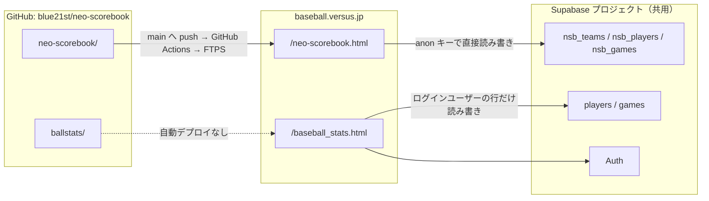

# システム構成

最終更新: 2026-11-14

コードを読んでまとめたもの。Supabase のダッシュボードやサーバー側の設定は見ていないので、そこに依存する項目は「要確認」としている。

## 全体図



## 共通の基盤

| 項目 | 内容 |
|---|---|
| 公開先 | `https://baseball.versus.jp/`（2本とも同じドメインの直下） |
| Supabase | 2本とも同じプロジェクト（ID は `ballstats/supabase_url_config.md` に記載） |
| リポジトリ | `blue21st/neo-scorebook`、ブランチは `main` のみ |
| 形態 | どちらもビルドなしの単一HTML。ライブラリはCDNから読み込む |

2本はテーブルを共有していない。同じ Supabase プロジェクトの中に、別々のテーブル群を持っている。

## neo-scorebook

| 項目 | 内容 |
|---|---|
| URL | https://baseball.versus.jp/neo-scorebook.html |
| 技術 | React 18 + Babel standalone + supabase-js v2（すべてCDN） |
| ファイル | `neo-scorebook.html`（UIと状態管理）、`scorebook-logic.js`（集計ロジック） |
| 認証 | なし。anon キーで直接アクセス |
| チームの扱い | `nsb_teams` の先頭1件を自チームとして使う（1チーム専用） |
| デプロイ | `.github/workflows/deploy.yml`。FTPの接続情報は GitHub Secrets |

### テーブル

| テーブル | 主なカラム | DDL |
|---|---|---|
| `nsb_teams` | `id`, `name` | リポジトリにない |
| `nsb_players` | `id`, `team_id`, `number`, `name`, `note` | リポジトリにない |
| `nsb_games` | `id`, `team_name`, `opponent`, `game_date`, `season`, `game_type`, `tournament`, `status`, `score_my`, `score_opp`, `end_inning`, `end_reason`, `game_log`(jsonb), `game_state`(jsonb) | `db/neo-scorebook_nsb_games.sql` |

`nsb_games` は1試合1行。`status` は `completed` / `in_progress` / `cold`。

### データの持ち方

- **`game_log`** が唯一の正。ハーフイニングの配列で、各要素は `{ inning, topBottom, atBats[] }`。
- 1打席（`atBats` の要素）は、打者（`playerId`, `number`, `name`, `order`, `pos`）、投球列（`pitches`）、イベント（`events`）、結果（`result`）、得点（`runsScored`, `runsScoredBy`）、対戦投手（`pitcherNumber`, `pitcherPlayerId`）、走者状況（`runnersAtStart`, `runnersAfter`）を持つ。
- 得点・打者成績・投手成績はすべて `game_log` から計算する（`scorebook-logic.js` の `calcStatsFromLog` / `calcScoreFromLog`）。
- **`game_state`** は中断再開用。イニング・カウント・走者・打順位置・両チームのオーダーとベンチ・交代履歴を保存する。
- 試合とチームの紐付けは `team_name`（文字列）。選手との紐付けは `game_log` 内の `playerId`。
- 相手チームの選手は登録せず、試合ごとに手入力したものを `game_state` に持つ。

### 画面構成

```
NeoScoreBookApp
├─ TeamSetupScreen        初回のチーム登録
├─ GamesTab               試合一覧（開始・再開・編集・削除）
├─ OrderRegistration      オーダー登録（MyTeamTab / OpponentTab）
├─ GameRecordScreen       記録画面（記録・経過・成績の3タブ）
│   ├─ InplayScreen         打席結果入力
│   ├─ SubstitutionModal    選手交代
│   ├─ GameInfoModal        試合情報編集
│   ├─ HistoryView          経過
│   └─ StatsView            試合内成績
├─ SeasonStatsTab         通算成績
├─ PlayerManagement       選手管理
└─ SettingsScreen         設定
```

## BALLSTATS

| 項目 | 内容 |
|---|---|
| URL | https://baseball.versus.jp/baseball_stats.html |
| 技術 | 素のJavaScript + supabase-js v2（CDN）。データの読み書きは REST API を fetch で直接呼ぶ |
| ファイル | `baseball_stats.html` 1本 |
| 認証 | Supabase Auth（メール＋パスワード、新規登録、パスワードリセット） |
| チームの扱い | 1アカウント＝1チーム。RLSで自分の行だけ見える |
| デプロイ | 自動デプロイなし。アップロード方法は要確認 |
| git | 現行版（v2026.11.03-b）は未管理。`ballstats/archive/` の旧版だけ管理されている |

### テーブル

| テーブル | 構造 | DDL |
|---|---|---|
| `players` | 1ユーザー1行。`user_id`, `data`（選手の配列をJSONで丸ごと保存） | `db/ballstats_players_games_rls.sql`（`user_id` 追加とRLS設定の部分のみ。テーブル作成文はない） |
| `games` | 1ユーザー1行。`user_id`, `data`（全試合の配列をJSONで丸ごと保存） | 同上 |

RLSポリシーは `user_id = auth.uid()`。

### データの持ち方

- 選手：`{ id, number, name, pos }`
- 試合：`{ id, season, type, tournament, date, opponent, us, them, videoUrl, stats[] }`
- 試合ごとの選手成績（`stats` の要素）：`{ pid, pa, rbi, run, sb, sba, details[] }`
- 打席詳細（`details` の要素）：`{ dir, res }`（打球方向と結果）
- `pa = -1` は未出場のフラグ。
- 保存のたびに全選手・全試合を1行にまとめて上書きする。
- 集計は打撃と走塁のみ。投手成績は持たない。

### 画面構成

成績一覧、選手一覧、試合一覧、試合追加、使い方、お問い合わせの6タブ。選手別の試合ごと成績モーダル、試合ごとのチーム打撃成績、試合への動画リンクがある。

## 運用の流れ

現状。2本の間にデータの受け渡しはない。

- **neo-scorebook**：試合中にその場で1球ずつ入力する。
- **BALLSTATS**：試合後に、スコアブックから選手別の打席結果を手で入力する。

目指す形。neo-scorebook で記録 →「スコアブックに変換」→「BALLSTATSに登録」→ BALLSTATS で閲覧。詳しくは [INTEGRATION.md](INTEGRATION.md)。

## 要確認の項目

| 項目 | なぜ確認が必要か |
|---|---|
| `nsb_*` テーブルのRLS設定 | 認証なしで anon キーから書き込めている。誰でも編集できる状態かどうか |
| `nsb_games` の `season` / `game_type` / `tournament` カラム | DDLには追記したが、Supabase側に適用済みかどうか |
| `nsb_teams` / `nsb_players` の定義 | DDLがリポジトリにない |
| `players` / `games` のテーブル作成文 | DDLがリポジトリにない |
| BALLSTATS のアップロード方法 | 自動デプロイに入っていない |
