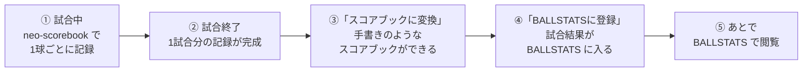

# 2本の関係と連携の進め方

最終更新: 2026-11-14

neo-scorebook と BALLSTATS は役割の違う2本で、将来は1つの流れでつなぐ。このファイルは、目指す流れ、今どこまでできているか、つなぐために埋める差、決めたことと未決のことをまとめる。

「目指す流れ」と「決めたこと」は青山の決定。それ以外は、コードを読んで整理した論点と案であり、決定事項ではない。

## 目指す流れ

役割分担はこうなる。

| | 役割 |
|---|---|
| neo-scorebook | **入力する側。** 試合中の記録と、スコアブックへの変換 |
| BALLSTATS | **見る側。** 登録された試合結果と成績の閲覧 |

## 今どこまでできているか

| ステップ | 状況 |
|---|---|
| ① 1球ごとに記録 | できている（neo-scorebook） |
| ② 1試合分の記録が完成 | できている（`nsb_games` に1試合1行で保存。終了・コールド・中断に対応） |
| ③ スコアブックに変換 | 未着手 |
| ④ BALLSTATSに登録 | 未着手。2本の間にデータの受け渡しはまだない |
| ⑤ BALLSTATSで閲覧 | 自チームの打撃・走塁はできている。投手成績と相手チームは未対応 |

今の BALLSTATS は、試合後にスコアブックを見ながら手で入力している。④ができると、この手入力が要らなくなる。

## 決めたこと

| 日付 | 内容 |
|---|---|
| 2026-11-14 | 2本は将来つなぐ。それまでは同じリポジトリ・同じフォルダで並べて開発する |
| 2026-11-14 | 流れは「neo-scorebook で記録 →『スコアブックに変換』→『BALLSTATSに登録』→ BALLSTATS で閲覧」 |
| 2026-11-14 | 選手登録は1か所にまとめる（2本で別々に登録しない） |
| 2026-11-14 | BALLSTATS に登録する範囲は、自チームの打撃・走塁だけでなく、投手成績も相手チームも全部 |

## まだ決めていないこと

| 項目 | 補足 |
|---|---|
| スコアブックの記入方式と出力 | 早稲田式か慶應式か。画面表示だけか、印刷・PDFも出すか |
| ログインの扱い | BALLSTATS はログインした本人のデータにしか書き込めない。neo-scorebook 側にもログインを入れるか、登録時だけ求めるか |
| 選手マスタをどちらに置くか | neo-scorebook の `nsb_players` か、BALLSTATS の `players` か |
| BALLSTATS への手入力を残すか | neo-scorebook で記録しなかった試合を、今まで通り手で入力できるようにするか |
| 過去データの扱い | BALLSTATS に入力済みの試合・選手をどう引き継ぐか |

## つなぐために埋める差

### 1. 選手マスタの一本化

今は2本が別々のテーブルに別々のIDで選手を持っている。

| | neo-scorebook | BALLSTATS |
|---|---|---|
| 保存先 | `nsb_players`（選手1人1行） | `players`（全選手を1行のJSONに保存） |
| ID | DBの連番 | `Date.now()` で作った数値 |
| 項目 | 背番号、名前、メモ | 背番号、名前、守備位置 |

1か所にまとめると決めたので、どちらかをマスタにして、もう一方はそれを読む形にする。BALLSTATS の過去の成績は BALLSTATS 側の選手IDに紐付いているため、移行時にIDの対応表が要る。

### 2. BALLSTATS が持てる情報を増やす

今の BALLSTATS の試合データは「スコア（自チーム・相手）」と「自チーム選手ごとの打席数・打点・得点・盗塁・盗塁企図・打席詳細（方向＋結果）」だけ。投手も相手チームも全部登録すると決めたので、次の受け皿が要る。

- 投手成績（投球回、被安打、奪三振、与四死球、失点など）
- 相手チームの選手と打席結果
- 試合経過（必要なら）

案：1球ごとの記録は `nsb_games.game_log` にすでに全部ある。BALLSTATS に同じものをコピーして持つのではなく、BALLSTATS から `nsb_games` を直接読む形にすると、二重持ちにならず、あとから集計項目を増やしやすい。BALLSTATS は全試合を1行のJSONにまとめて保存しているので、1球ごとの記録まで詰め込むと1行が大きくなりすぎる懸念もある。

### 3. ログインとデータの持ち主

| | neo-scorebook | BALLSTATS |
|---|---|---|
| 認証 | なし | メール＋パスワード |
| データの持ち主 | 区別なし（先頭1チーム固定） | ログインユーザーごと（RLS） |

neo-scorebook から BALLSTATS のデータに書き込むには、誰のデータとして登録するかを neo-scorebook 側が知っている必要がある。ログインの扱いは未決。

### 4. 同じ試合の二重登録を防ぐ

「BALLSTATSに登録」を2回押したときに試合が2つできないよう、BALLSTATS 側の試合に neo-scorebook の試合ID（`nsb_games.id`）を持たせる必要がある。記録を修正して登録し直したときは上書きになる。

### 5. 結果の語彙

打席結果の呼び方が2本で違う。登録時に変換するか、どちらかに揃える。

| 意味 | neo-scorebook | BALLSTATS |
|---|---|---|
| 単打 | ヒット | 単打（ヒットも集計上は受け付ける） |
| 犠打 | 送りバント、バント | 犠打 |
| 野選 | FC（野選） | フィルダースチョイス |
| 四球 | フォアボール | 四球 |
| 死球 | デッドボール | 死球 |
| 故意四球 | 故意四球 | 敬遠 |
| 三振 | 三振（K）、三振（KS） | 見逃し三振、空振り三振 |
| 妨害 | なし | 打撃妨害、走塁妨害 |

neo-scorebook は結果文字列に特定の語が含まれるかで集計し（`scorebook-logic.js`）、BALLSTATS は結果文字列の完全一致で集計する。

### 6. 試合情報の項目名

| 意味 | neo-scorebook | BALLSTATS |
|---|---|---|
| 日付 | `game_date` | `date` |
| シーズン | `season` | `season` |
| 種別 | `game_type` | `type` |
| 大会名 | `tournament` | `tournament` |
| 相手 | `opponent` | `opponent` |
| スコア | `score_my` / `score_opp` | `us` / `them` |
| 動画リンク | なし | `videoUrl` |

### 7. スコアブックへの変換（③）

1球ごとの記録から、打席ごとのマス（カウント、結果、進塁、得点、アウト）を描く機能。材料は `game_log` に揃っている（投球列、結果、打席前後の走者、得点者、選手交代）。方式と出力先が決まれば設計に入れる。資料として `reference/公認野球規則_記録について_officialrule_900.pdf` がある。

## 進める順番の案

1. **土台を整える。** BALLSTATS の現行版を git 管理に入れる。全テーブルのDDLを `db/` に揃える。neo-scorebook のRLS設定を確認する。
2. **未決事項を決める。** 特にログインの扱いと選手マスタの置き場所。この2つが決まらないと④の設計に入れない。
3. **選手マスタを一本化する。**
4. **「BALLSTATSに登録」を作る。** まず自チームの打撃・走塁（今の BALLSTATS の項目）から始め、動いたら投手成績・相手チームに広げる。
5. **BALLSTATS に投手成績・相手チームの表示を足す。**
6. **「スコアブックに変換」を作る。** ④⑤とは独立しているので、方式が決まれば並行して進められる。

それまでの間も、集計ロジックは `scorebook-logic.js` に寄せ続ける。UIから切り離された関数になっていれば、登録時の変換にも BALLSTATS 側の表示にもそのまま使える。
